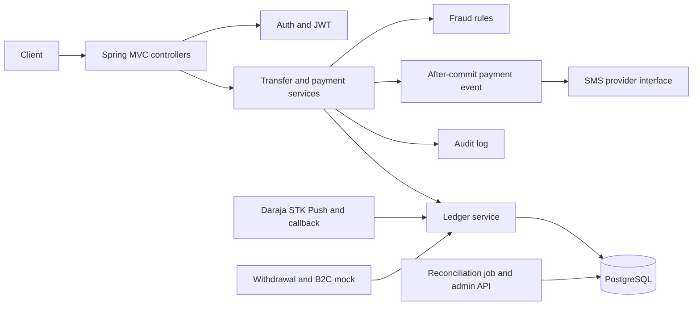
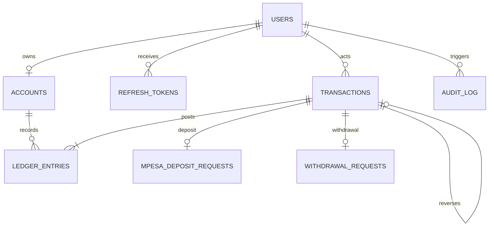

# wallet-service

A Spring Boot 4 wallet backend for Kenyan phone numbers and KES payments. The service uses minor units (`long` cents), a double-entry ledger, M-Pesa Daraja STK Push deposits, idempotent transfers, asynchronous mocked withdrawals, fraud controls, audit records, and SMS notifications.

## Features

- E.164 phone normalization for Kenyan `07xx`, `01xx`, `254...`, and `+254...` numbers.
- BCrypt password hashing, short-lived JWT access tokens, rotating hashed refresh tokens, login lockout, and per-IP auth throttling.
- User and administrator roles, method-level authorization, request IDs, RFC 7807 error responses, CORS allow-list, and request-body limits.
- Append-only balanced ledger, locked account updates, cached balance reconciliation, and transaction history.
- Transfer idempotency, configurable limits and tiered fees, and generic handling for unavailable recipients.
- Daraja STK Push deposits with tokenized callback path, request matching, duplicate delivery handling, status polling, and expiry.
- Withdrawal holds, asynchronous B2C mock, automatic failure reversal, and administrator reversal records.
- Configurable velocity and amount fraud rules, security audit log, and after-commit SMS notifications.
- OpenAPI docs in dev, Actuator health and info endpoints, PostgreSQL Testcontainers suite, JaCoCo service coverage gate, and CI dependency scanning.

## Architecture



## Data model



`balance_minor` is a cache. Its authoritative value is the signed ledger sum (`CREDIT - DEBIT`). Migrations are under `src/main/resources/db/migration`; add new migrations rather than editing an applied migration.

## Requirements

- Java 25
- Docker Desktop with Compose for the local stack and PostgreSQL integration tests
- Maven wrapper (`mvnw` / `mvnw.cmd`)

## Run with Docker Compose

Copy `.env.example` to `.env`, then replace the local database password and generate secrets. For example, generate a JWT key with `openssl rand -base64 48` and a separate callback token with `openssl rand -hex 32`.

```sh
cp .env.example .env
docker compose up --build
```

The API listens on `http://localhost:8080`; PostgreSQL is bound to localhost on port `5432`. Flyway applies migrations at startup. The app health endpoint is `GET /actuator/health`. Swagger UI and OpenAPI are available in dev at `/swagger-ui/index.html` and `/v3/api-docs`.

## Run locally

Start PostgreSQL 16 and create a database named `wallet`. Set `DB_URL`, `DB_USERNAME`, and `DB_PASSWORD`, then run:

```sh
./mvnw spring-boot:run
```

On Windows PowerShell:

```powershell
./mvnw.cmd spring-boot:run
```

The default profile is `dev`; set `SPRING_PROFILES_ACTIVE=prod` only with production configuration. The `prod` profile requires a strong non-default `JWT_SECRET`, database settings, M-Pesa credentials and HTTPS callback base URL, a callback token of at least 32 URL-safe characters, and Africa's Talking credentials. It disables Swagger and verbose SQL.

## Environment variables

| Variable | Purpose |
| --- | --- |
| `SPRING_PROFILES_ACTIVE` | `dev` or `prod`; tests use the `test` profile |
| `DB_URL` | PostgreSQL JDBC URL |
| `DB_USERNAME`, `DB_PASSWORD` | Database credentials |
| `DB_POOL_MIN`, `DB_POOL_MAX` | Hikari connection pool bounds |
| `JWT_SECRET` | HMAC key; at least 32 bytes and not the dev default in prod |
| `CORS_ALLOWED_ORIGINS` | Comma-separated browser origins |
| `TRANSFER_MINIMUM_MINOR`, `TRANSFER_MAXIMUM_MINOR`, `TRANSFER_DAILY_LIMIT_MINOR` | Transfer bounds in minor units |
| `MPESA_BASE_URL` | Daraja base URL; defaults to Safaricom sandbox |
| `MPESA_CONSUMER_KEY`, `MPESA_CONSUMER_SECRET` | Daraja OAuth credentials |
| `MPESA_SHORTCODE`, `MPESA_PASSKEY` | Daraja STK Push settings |
| `MPESA_CALLBACK_BASE_URL`, `MPESA_CALLBACK_TOKEN` | Public HTTPS callback origin and random path secret |
| `MPESA_CALLBACK_ALLOWED_IPS` | Optional comma-separated exact remote IP allow-list |
| `MPESA_CONNECT_TIMEOUT_MS`, `MPESA_READ_TIMEOUT_MS` | Daraja client timeouts |
| `B2C_MOCK_SUCCESS`, `B2C_MOCK_DELAY_MS` | Local mocked withdrawal outcome and delay |
| `FRAUD_TRANSFERS_PER_MINUTE`, `FRAUD_SINGLE_AMOUNT_FLAG_MINOR` | Velocity and amount rules |
| `FRAUD_NEW_RECIPIENTS_WINDOW_MINUTES`, `FRAUD_NEW_RECIPIENTS_LIMIT`, `FRAUD_FAILED_LOGIN_COUNT` | Additional fraud thresholds |
| `AT_USERNAME`, `AT_API_KEY`, `AT_SENDER_ID`, `AT_BASE_URL` | Africa's Talking sandbox SMS settings |

Never commit `.env`; it is ignored by Git and excluded from Docker build context.

## API examples

Register and log in (save the returned access token and refresh token securely):

```sh
curl -sS http://localhost:8080/api/auth/register \
  -H 'Content-Type: application/json' \
  -d '{"phone":"0712345678","password":"LongPass123"}'

curl -sS http://localhost:8080/api/auth/login \
  -H 'Content-Type: application/json' \
  -d '{"phone":"0712345678","password":"LongPass123"}'
```

Transfer KES 100.00 (10,000 minor units) to another registered wallet:

```sh
curl -sS http://localhost:8080/api/transfers \
  -H "Authorization: Bearer $ACCESS_TOKEN" \
  -H 'Idempotency-Key: transfer-2026-0001' \
  -H 'Content-Type: application/json' \
  -d '{"receiverPhone":"0712345679","amountMinor":10000}'
```

View the cached balance and paged history:

```sh
curl -sS http://localhost:8080/api/accounts/me -H "Authorization: Bearer $ACCESS_TOKEN"
curl -sS 'http://localhost:8080/api/transactions?page=0&size=25&type=TRANSFER' \
  -H "Authorization: Bearer $ACCESS_TOKEN"
```

Start an M-Pesa deposit or withdrawal (amounts are minor units):

```sh
curl -sS http://localhost:8080/api/deposits/mpesa \
  -H "Authorization: Bearer $ACCESS_TOKEN" -H 'Idempotency-Key: deposit-2026-0001' \
  -H 'Content-Type: application/json' -d '{"phone":"0712345678","amountMinor":10000}'

curl -sS http://localhost:8080/api/withdrawals \
  -H "Authorization: Bearer $ACCESS_TOKEN" -H 'Idempotency-Key: withdrawal-2026-0001' \
  -H 'Content-Type: application/json' -d '{"phone":"0712345678","amountMinor":10000}'
```

The callback URL is formed as `MPESA_CALLBACK_BASE_URL/api/mpesa/callback/MPESA_CALLBACK_TOKEN`. The callback token is a path secret and must be long and random. Configure the externally reachable HTTPS URL with Safaricom's sandbox settings.

## Daraja sandbox setup

Create a Daraja sandbox app and set its consumer key, consumer secret, shortcode, and passkey. Provide a publicly reachable HTTPS callback base URL and a random callback token. Configure the same callback URL in the provider app. Use a tunnel only for local development and rotate the callback token if it is exposed. The callback handler verifies the checkout ID, amount, and normalized phone against the pending request; it does not treat the callback as signed or trusted.

## Tests and quality checks

```sh
./mvnw clean verify
```

The standard unit suite runs without Docker. PostgreSQL integration tests use Testcontainers and are skipped automatically if Docker is unavailable; they exercise migrations, PostgreSQL JSONB and trigger behavior, duplicate callbacks, idempotent transfers, auth refresh/logout, and 100 parallel transfers. JaCoCo enforces the configured service-layer line-coverage threshold during `verify`. CI also runs OWASP Dependency-Check and fails on CVSS 7.0 or higher. An `NVD_API_KEY` GitHub Actions secret is recommended to avoid NVD rate limits.

## Runtime notes

- Withdrawals use `MockB2cClient`; a production Daraja B2C integration must replace it before real disbursements.
- The in-memory IP limiter is per application process. Use a shared limiter such as Redis before horizontal scaling.
- The callback path token and optional IP allow-list compensate for Daraja STK callback signature limitations; they do not provide provider-signed nonrepudiation.
- Run the reconciliation endpoint as an administrator and investigate mismatches; the service intentionally never repairs ledger balances automatically.
